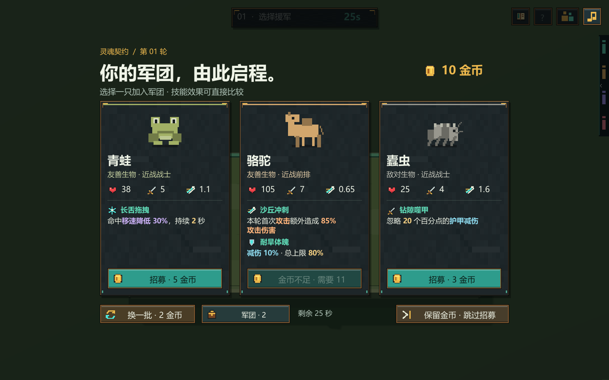
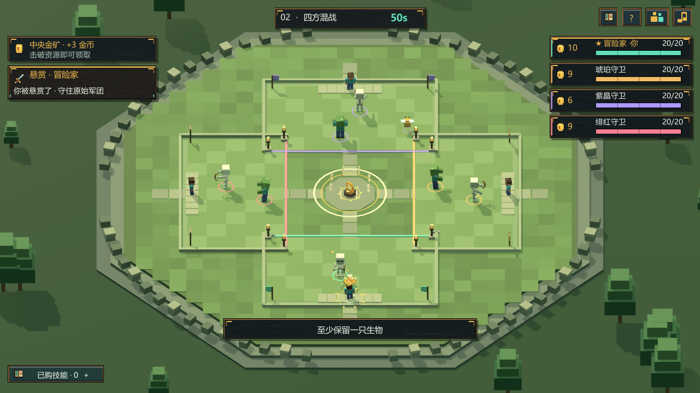
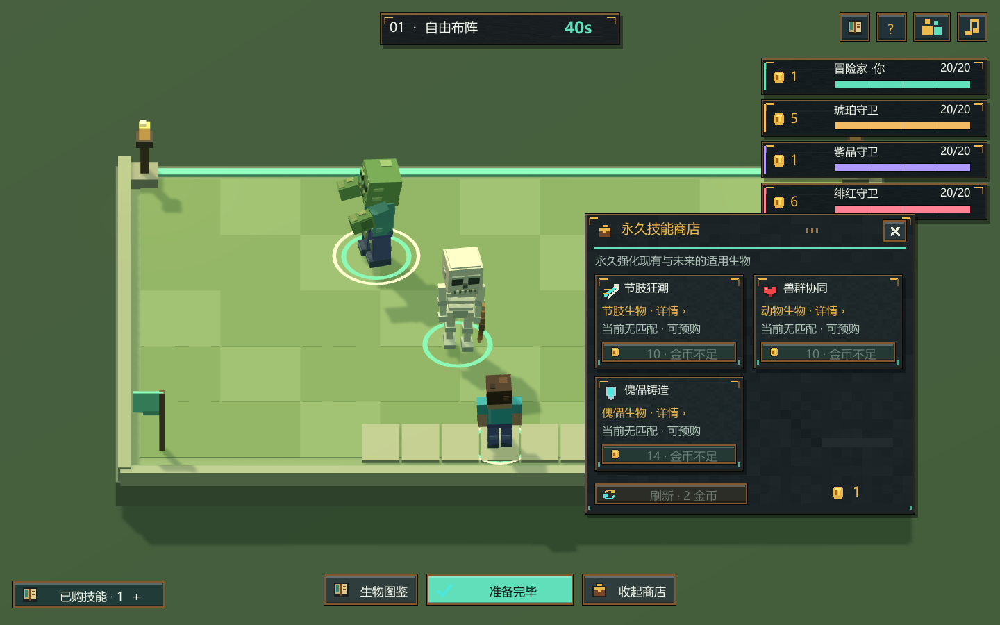
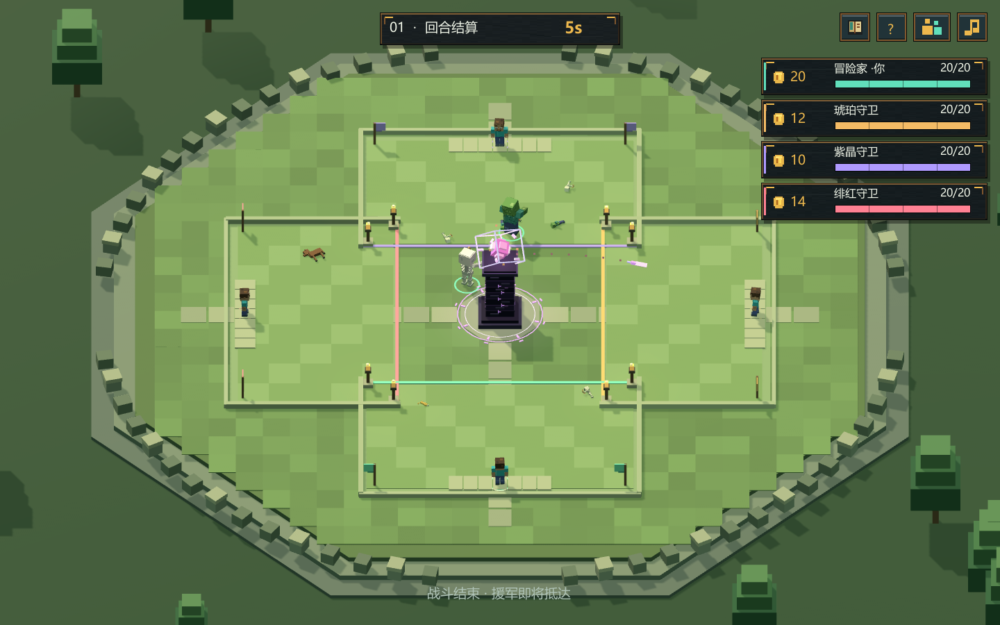
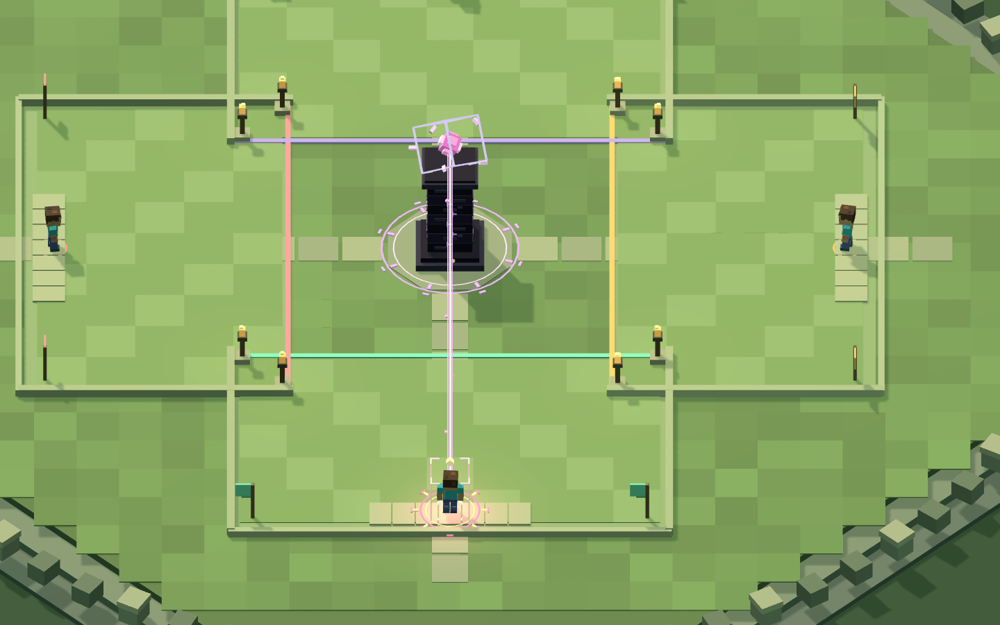

# 方块斗兽场 · Unity 原型 0.8.0

四位指挥官招募方块生物、自由布阵，再让军团自动混战。支持本机对战三位电脑、局域网联机和自行配置 TCP 内网穿透。

[下载 v0.8.0 Windows 试玩版](https://github.com/hhhhhhhqcc/BlockArena/releases/tag/v0.8.0) · [生物图鉴](生物图鉴.md) · [验证记录](验证记录.md)

0.8.0 加入付费更换招募候选、军团遣散、领先者悬赏和中央随机事件，调整普通击杀金与排名收入。保留悬停 1 秒展开精简技能、招募卡片直接比较效果、侧边指挥官血条及逐人水晶处决。本版使用协议 v4，旧版客户端不能加入。新版包含此前未单独发布的 0.7.x 改动，构建与验证结果见验证记录。



使用 Unity **2022.3.62f3c1**，Built-in 渲染管线。本仓库根目录就是 Unity 工程；Windows 客户端在 Releases 下载，构建文件与 Unity 缓存不提交到 Git。网页原型不属于本仓库。

## 开始试玩

从上方 Release 下载 Windows 试玩压缩包，完整解压后双击 **开始游戏.cmd**，或运行 `Builds/Windows-0.8.0/BlockArena.exe`。试玩无需安装 Unity、.NET SDK 或 Node，请保留完整目录，不要只拷贝 exe。操作与联机说明见 [Windows 试玩说明](Windows-试玩说明.md)。从 GitHub 下载源码后需先通过下述 Unity 菜单构建。

- **单人试玩**：本机开服并添加三位电脑。
- **本机开服**：等待朋友加入，再点击开始；空位可由电脑补齐。
- **加入服务器**：输入房主 IP / 穿透域名及 TCP 端口。
- 昵称、地址和端口会保存在本机。玩家最多四位，无需中心服务器或账号。

开发：克隆本仓库或下载源码压缩包，在 Unity Hub 中添加仓库根目录，并使用上述 Unity 2022.3 LTS 版本打开。打开 `Assets/Scenes/Arena.unity` 后点击 Play；菜单 **方块斗兽场 → 打开试玩场景** 也可打开。菜单 **方块斗兽场 → 构建 Windows 试玩版** 会在 `Builds/Windows-0.8.0` 生成客户端，再运行根目录启动脚本。本机安装路径匹配时，也可使用 **打开Unity工程.cmd**。

```powershell
git clone https://github.com/hhhhhhhqcc/BlockArena.git
```

## 玩法

每位指挥官 20 点生命，开局 12 金币、两只基础生物。开局及每轮战后，弹出三个不同的生物，花金币购买其中一只，或跳过保留金币。招募卡片直接显示技能图标、名称、精简实际效果和关键数值，购买前即可比较能力。待招募时可花 **2 金币「换一批」**，新候选组合保证有变化；刷新不会增加本轮购买次数，仍然最多三选一购买一只，旧候选的延迟点击不会误买新商品。超时由服务器购买可负担的生物；全部买不起时自动跳过。军团跨回合保留，没有阵容数量硬上限。

招募或准备阶段可点击 **「军团」** 打开管理列表，默认收起。可以遣散自己已有的生物，返还该生物**实际购买价的一半，向下取整**；免费初始生物返还 0，至少保留一只。尚未完成招募时也能遣散筹钱，遣散不会替你完成或跳过招募。

本版按 **Minecraft Java 1.21.11** 收录 **89 种独立生物**，覆盖友善、中立、敌对及首领；不重复列颜色、幼体和骑乘组合，巨人、幻术师等命令生物也在目录中。每种有 1～3 个可执行天赋，共 154 项命名天赋，包括护甲、再生、闪避、毒、灼烧、治疗、穿甲、反伤、位移、眩晕、召唤和分裂等。它们采用本游戏的自动战斗规则，并非原版 AI 的逐项复刻。完整属性见 **生物图鉴.md** 和游戏内图鉴。

生物按强度分为 6 阶，售价 3～80 金币：第 1/3/5/7/9 轮依次开放最高 2/3/4/5/6 阶招募池。第 9 轮起可能刷出凋灵（75 金币）、末影龙（80 金币）及监守者等后期生物；高阶解锁后仍可刷出低价生物。

准备时只显示自己的独立领地。已有生物在地上活动，可拖到地盘内任何位置，没有格子。WASD / 方向键或点地面移动 Steve。点击生物查看属性，点击“准备完毕”提前开战。拖动摆位和购物会取消准备。拖放后会保留落点，直到服务器确认此次操作，避免网络延迟造成回弹；抓取位置保留鼠标与生物的偏移。

准备阶段按 **M** 或点击商店查看最多 4 项未掌握的随机永久技能。每轮开始免费换货，准备阶段不再自动刷新，可花 **2 金币**主动刷新。13 项物种/类别技能每项只需买一次，影响匹配的现有及未来生物；买后移出当前货架。全部掌握后显示空态并停止收取刷新费用。商店和已购技能收藏均可查看效果、完整适用生物与当前军团匹配数量；悬停技能会在场上高亮匹配的己方生物。

开战后镜头平滑拉远至全场，四个方向的军团自动混战。滚轮缩放、中键拖动镜头，**F** 恢复默认视角；准备和战斗各自记住缩放。放大后的生物更易辨认。生物血条默认隐藏；悬停任意阵营的生物时立即显示生命条、图标化实际属性、护盾、所属玩家和异常状态，持续停留同一只生物 **1 秒**后再平滑展开精简技能。技能显示触发条件、数值、持续时间及冷却，包含永久技能授予的能力；准备属性也包含已购买强化，分裂体显示自身实际属性。移开、切换个体或进入新回合会重新计时。

介绍中的数值和关键效果按类型加粗着色：伤害偏橙、生命与治疗偏青绿、护甲与护盾偏蓝、控制偏紫。指挥官生命条在战斗时常驻右侧，其他阶段平滑收至屏幕边缘，留下简洁生命刻度；鼠标移到边缘或展开面板上可查看，离开后自动收起。拖动生物、移动商店或操作覆盖窗口时不触发边缘展开，避免遮挡布阵。按军团全部死亡的先后排名扣除指挥官生命；战斗超时仍存活者按剩余总生命排序。同帧团灭并列。军团下一轮恢复满血。

击杀敌方原始军团生物时，**每只 1 金币即时到账，每位玩家每轮最多 5 金币**；超过上限的击杀仍计数。毒、灼烧及己方召唤物击杀归其主人，分裂体与召唤小怪本身不给普通击杀金。战后只补发 **基础 6 + 排名奖励 4/3/2/2**，不重复发放已经到账的奖励。常规整轮收入为 **6 + min(5，有效击杀数) + 排名奖励**，范围 **8～15 金币**，悬赏、事件和遣散返还另计。并列共享名次奖励，下一名按并列人数顺延。

开战时按**指挥官生命更高 → 上轮名次更靠前 → 军团战力更高**选定本轮领先者，整场锁定；三项最高仍并列时不设目标。军团战力为全军最大生命、开场护盾与 10 秒理论普攻伤害之和。领先指挥官有琥珀色皇冠与符文，所属军团带琥珀标记。其他玩家每击杀其 **3 只原始生物额外获得 1 金币**，按各自进度计算，每人每轮最多 **3 金币**；该悬赏独立于普通击杀金上限。

每轮招募开始时为即将到来的战斗抽取中央事件：**50% 无事件、30% 中立劫掠兽首领、20% 金币资源**。完成购买或跳过后播放预告，开战时目标在场中央出现。首领追击存活军团**当前生命总和最高**的一方，击杀奖励 **4 金币**；金币资源不会攻击，击破奖励 **3 金币**。奖励只发给最后一击所属玩家一次，毒、灼烧及召唤物的最后一击也能领取。中立目标不给普通击杀数或领先者悬赏，不参加胜负与排名；事件奖励另计，不占 5 金币普通击杀上限。



新版 UI 采用石板、铜金边饰和灵魂青配色；按 **B** 查看可搜索的全物种图鉴，支持中文名称、类别、标签及英文 ID。0.8.0 使用协议 **v4**，服务器与所有客户端请统一使用同一版文件；旧版 v3 客户端不能加入。




战后中央升起黑曜石柱，悬浮水晶逐一攻击败方。普通受击按扣血增强；生命将归零时触发 **射线连接 → 符文封印 → 能量爆炸 → Steve 方块碎裂 → 灵魂升起**。镜头拉近当前目标，待灵魂消散后拉回完整竞技场并短暂停留，才开始攻击下一名玩家；全部结束后恢复玩家原来的缩放和平移。结算等待随实际演出时长调整，下一轮和最终胜负窗口均会等演出完成。招募、准备和战斗最后 5 秒有提示音，最后 3 秒加急；不为重连重放已错过的提示。





## 局域网与内网穿透

默认 **TCP 7777**，可在开服前修改。房主窗口会显示检测到的本机 IPv4（多网卡时请选择与朋友同网段的地址）。

1. 局域网：房主点击“本机开服”，朋友填写房主局域网 IPv4 和端口。
2. 穿透：用你选择的 frp、NATAPP、花生壳等工具，把一个 **TCP** 外网入口映射到房主 `127.0.0.1:7777`。
3. 朋友填写映射后的域名 / IP 与**外网端口**；主机自己仍通过本机回环连接。
4. 若 Windows 防火墙询问，请为实际使用的专用网络允许游戏通信。

这是原生 TCP 协议，不能填网页 URL，也不能使用仅支持 HTTP 的临时网页隧道。虚拟组网也可直接使用分配的虚拟局域网 IP。工程不绑定特定穿透供应商。

朋友必须在开始对战前加入。断线有重连续接身份，超过 5 秒转由 AI 操作。游戏中可从“房间”点击重新连接。房主退出会关闭服务器；关闭专用服务器或重启进程会丢失内存中的对局。

如只运行服务器，双击 **启动专用服务器.cmd**，默认 7777；命令行传入首个参数可改端口。它运行同一客户端的无画面模式：

```powershell
.\Builds\Windows-0.8.0\BlockArena.exe -batchmode -nographics -arena-server -port 7777 -logFile server.log
```

第一位连接者获得房主权限。服务器没有自动公网发现或匹配。

## 工程与验证

- `Assets/Scripts/Core`：纯 C# 权威规则，20Hz 模拟。
- `Assets/Scripts/Networking`：长度前缀 TCP、连接绑定身份、私有招募候选、10Hz 状态同步。
- `Assets/Scripts/Presentation`：3D 体素模型、阴影灯光、对象复用、动画与平滑镜头。
- `Assets/Scripts/Runtime`：Unity 入口、原生浮动 UI、输入和 JSON 适配。
- `Assets/Editor/ArenaBuild.cs`：场景配置、编译验证及 Windows 构建。
- `Tools/CoreChecks`、`Tools/NetworkChecks`：不依赖 Unity 或第三方 NuGet 的 .NET 8 检查程序。

```powershell
dotnet run --project Tools/CoreChecks -c Release
dotnet run --project Tools/NetworkChecks -c Release
```

独立怪物属性与战斗均由服务器计算。怪物数量没有玩法限制；很大的军团仍受到主机 CPU、绘制能力和网络带宽限制。当前尚未加入账号、存档和匹配；方块模型与原创音频均可在本地生成。菜单/准备与战斗使用同主题的三首循环音乐，购买、金币、拖放、开战、普通战斗和水晶仪式各有对应音效。右上音量按钮可分别调节背景音乐与音效或静音，设置会保存在本机。

音乐与音效的来源、生成方法及接入说明见 [原创音频说明](Tools/ArenaAudio-Notes.md)。实际编译、运行与画面检查结果见 [验证记录](验证记录.md)。
