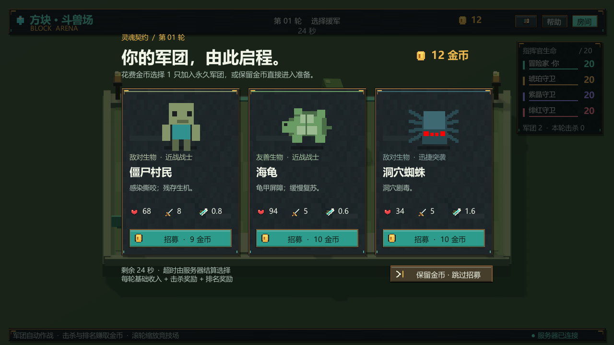
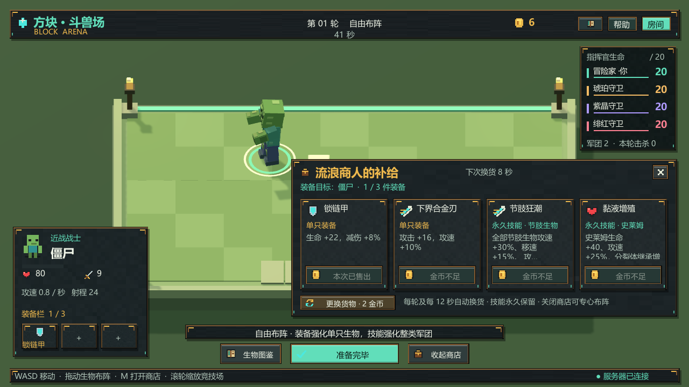
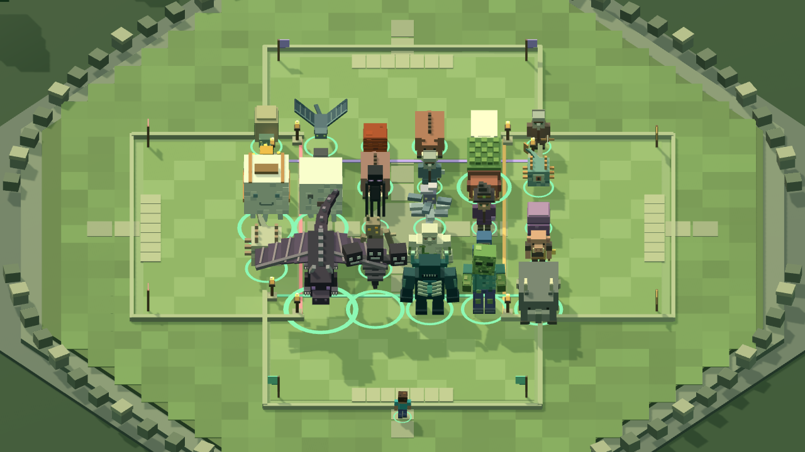

# 方块斗兽场 · Unity 原型 0.4.0

四位指挥官招募方块生物、自由布阵，再让军团自动混战。支持本机对战三位电脑、局域网联机和自行配置 TCP 内网穿透。

[下载 Windows 试玩版](https://github.com/hhhhhhhqcc/BlockArena/releases/latest) · [生物图鉴](生物图鉴.md) · [验证记录](验证记录.md)



使用 Unity **2022.3.62f3c1**，Built-in 渲染管线。本仓库根目录就是 Unity 工程；Windows 客户端在 Releases 下载，构建文件与 Unity 缓存不提交到 Git。网页原型不属于本仓库。

## 开始试玩

在 [Releases](https://github.com/hhhhhhhqcc/BlockArena/releases) 下载 **BlockArena-0.4.0-Windows-x64.zip**，完整解压，进入 `BlockArena-0.4.0` 后双击 **开始游戏.cmd**；或运行 `Builds/Windows/BlockArena.exe`。试玩无需安装 Unity、.NET SDK 或 Node，不要只拷贝 exe。

- **单人试玩**：本机开服并添加三位电脑。
- **本机开服**：等待朋友加入，再点击开始；空位可由电脑补齐。
- **加入服务器**：输入房主 IP / 穿透域名及 TCP 端口。
- 昵称、地址和端口会保存在本机。玩家最多四位，无需中心服务器或账号。

开发：克隆本仓库或下载源码压缩包，在 Unity Hub 中添加仓库根目录，并使用上述 Unity 2022.3 LTS 版本打开。打开 `Assets/Scenes/Arena.unity` 后点击 Play；菜单 **方块斗兽场 → 打开试玩场景** 也可打开。菜单 **方块斗兽场 → 构建 Windows 试玩版** 会在 `Builds/Windows` 生成客户端，再运行根目录启动脚本。本机安装路径匹配时，也可使用 **打开Unity工程.cmd**。

```powershell
git clone https://github.com/hhhhhhhqcc/BlockArena.git
```

## 玩法

每位指挥官 20 点生命，开局 12 金币、两只基础生物。开局及每轮战后，弹出三个不同的生物，花金币购买其中一只，或跳过保留金币。超时由服务器购买可负担的生物；全部买不起时自动跳过。军团永久保留，没有阵容数量硬上限。

本版按 **Minecraft Java 1.21.11** 收录 **89 种独立生物**，覆盖友善、中立、敌对及首领；不重复列颜色、幼体和骑乘组合，巨人、幻术师等命令生物也在目录中。每种有 1～3 个可执行天赋，共 154 项命名天赋，包括护甲、再生、闪避、毒、灼烧、治疗、穿甲、反伤、位移、眩晕、召唤和分裂等。它们采用本游戏的自动战斗规则，并非原版 AI 的逐项复刻。完整属性见 **生物图鉴.md** 和游戏内图鉴。

生物按强度分为 6 阶，售价 3～80 金币：第 1/3/5/7/9 轮依次开放最高 2/3/4/5/6 阶招募池。第 9 轮起可能刷出凋灵（75 金币）、末影龙（80 金币）及监守者等后期生物；高阶解锁后仍可刷出低价生物。

准备时只显示自己的独立领地。已有生物在地上活动，可拖到地盘内任何位置，没有格子。WASD / 方向键或点地面移动 Steve。点击生物查看属性，点击“准备完毕”提前开战。拖动摆位和购物会取消准备。拖放后会保留落点，直到服务器确认此次操作，避免网络延迟造成回弹；抓取位置保留鼠标与生物的偏移。

准备阶段按 **M** 或点击商店查看 4 件随机商品（通常为2件装备、2项未拥有的永久技能；技能不足时由装备补齐）。每轮及准备中每 12 秒免费换货，也可花 2 金币手动刷新。先选中场上的生物再买装备，每只最多装备 3 件不同物品；13 项物种/类别技能每项只需买一次，影响匹配的现有及未来生物。共 11 件装备，装备不消耗，回合结束仍保留。商店关闭后即可继续布阵。

开战后镜头平滑拉远至全场，四个方向的军团自动混战。滚轮缩放、中键拖动镜头，**F** 恢复默认视角；准备和战斗各自记住缩放。放大后的生物更易辨认。生物血条默认隐藏；悬停任意阵营的生物才显示该生物血条，以及图标化属性、当前/最大生命、护盾、所属玩家、技能、装备和异常状态。分裂体显示实际属性。指挥官生命保留在右上角的透明窗口。按军团全部死亡的先后排名扣除指挥官生命；战斗超时仍存活者按剩余总生命排序。同帧团灭并列。军团下一轮恢复满血。

每轮结束立即发放：**基础 6 + 击杀数 × 1 + 排名奖励**。第 1/2/3/4 名的排名奖励为 4/3/2/1；结算展示明细。只统计敌方原始军团生物，分裂/召唤的小怪不给额外击杀金币；由毒、灼烧或己方召唤物杀敌也归属其主人。并列共享名次奖励，下一名按并列人数顺延。

新版 UI 采用石板、铜金边饰和灵魂青配色；按 **B** 查看可搜索的全物种图鉴，支持中文名称、类别、标签及英文 ID。0.4.0 网络协议为 **v3**，联机双方请使用这一版文件，旧客户端不能加入。





## 局域网与内网穿透

默认 **TCP 7777**，可在开服前修改。房主窗口会显示检测到的本机 IPv4（多网卡时请选择与朋友同网段的地址）。

1. 局域网：房主点击“本机开服”，朋友填写房主局域网 IPv4 和端口。
2. 穿透：用你选择的 frp、NATAPP、花生壳等工具，把一个 **TCP** 外网入口映射到房主 `127.0.0.1:7777`。
3. 朋友填写映射后的域名 / IP 与**外网端口**；主机自己仍通过本机回环连接。
4. 若 Windows 防火墙询问，请为实际使用的专用网络允许游戏通信。

这是原生 TCP 协议，不能填网页 URL，也不能使用仅支持 HTTP 的临时网页隧道。虚拟组网也可直接使用分配的虚拟局域网 IP。工程不绑定特定穿透供应商。

朋友必须在开始对战前加入。断线有重连续接身份，超过 5 秒转由 AI 操作。游戏中可从“房间”点击重新连接。房主退出会关闭服务器；关闭专用服务器或重启进程会丢失内存中的对局。

如只运行服务器，双击 **启动专用服务器.cmd**，默认 7777；命令行传入首个参数可改端口。它运行同一客户端的无画面模式：

```powershell
.\Builds\Windows\BlockArena.exe -batchmode -nographics -arena-server -port 7777 -logFile server.log
```

第一位连接者获得房主权限。服务器没有自动公网发现或匹配。

## 工程与验证

- `Assets/Scripts/Core`：纯 C# 权威规则，20Hz 模拟。
- `Assets/Scripts/Networking`：长度前缀 TCP、连接绑定身份、私有招募候选、10Hz 状态同步。
- `Assets/Scripts/Presentation`：3D 体素模型、阴影灯光、对象复用、动画与平滑镜头。
- `Assets/Scripts/Runtime`：Unity 入口、原生浮动 UI、输入和 JSON 适配。
- `Assets/Editor/ArenaBuild.cs`：场景配置、编译验证及 Windows 构建。
- `Tools/CoreChecks`、`Tools/NetworkChecks`：不依赖 Unity 或第三方 NuGet 的 .NET 8 检查程序。

```powershell
dotnet run --project Tools/CoreChecks -c Release
dotnet run --project Tools/NetworkChecks -c Release
```

独立怪物属性与战斗均由服务器计算。怪物数量没有玩法限制；很大的军团仍受到主机 CPU、绘制能力和网络带宽限制。当前尚未加入账号、存档、匹配、音频资源和正式美术资源；表现使用本地程序生成的方块模型。

实际编译、运行与画面检查结果见 `验证记录.md`。
